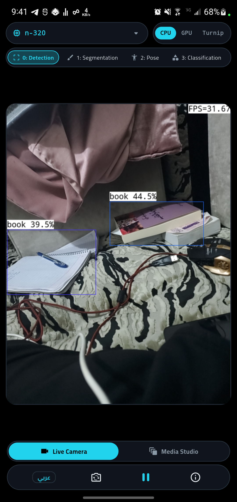
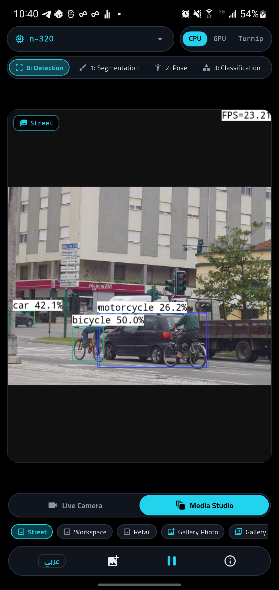
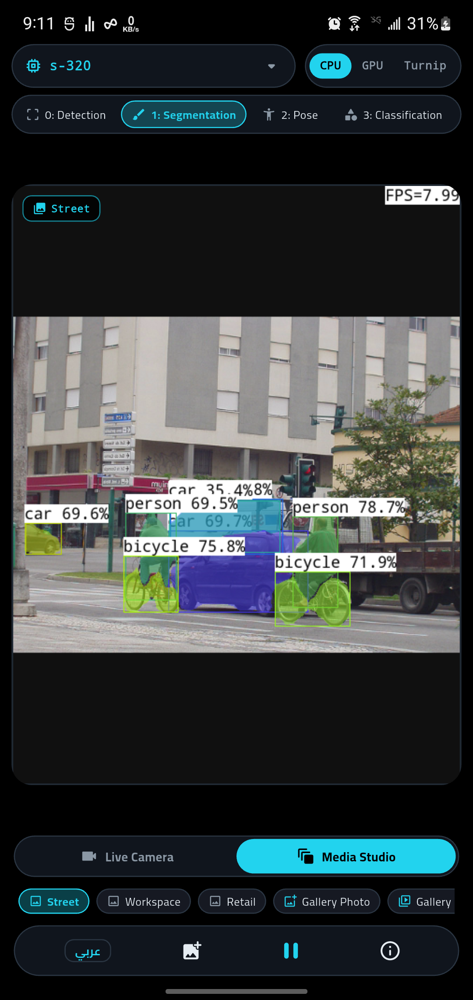
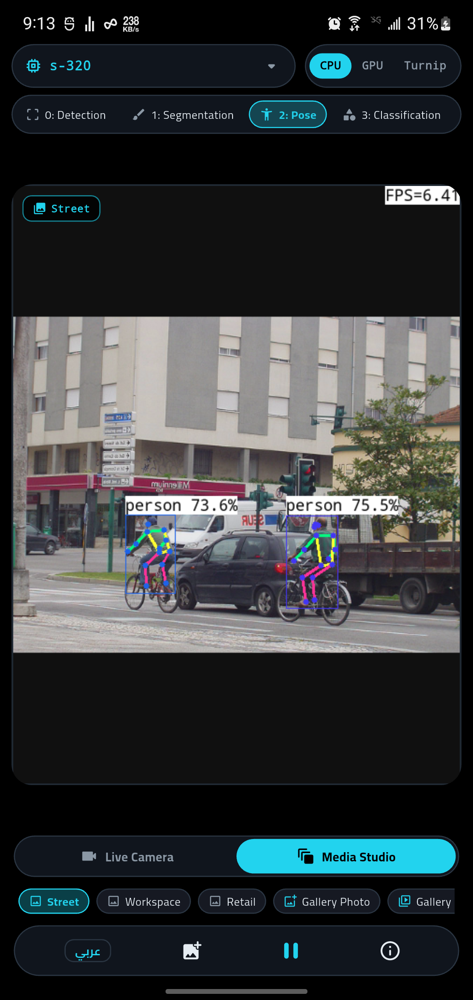

# YOLO11 NCNN Multi-Task Edge AI Studio for Android

[](LICENSE)
[](https://developer.android.com)
[](https://github.com/Tencent/ncnn)
[](https://github.com/nihui/ncnn-android-yolo11)
[](mobile_app/)
[](https://github.com/tahadeab-ai/object-detector/releases/tag/v2.0.0)

**YOLO11 NCNN Edge AI Studio** (`tahadeab-ai/object-detector`) is a production-grade, real-time edge computer vision studio for Android devices. Engineered and benchmarked on Qualcomm Snapdragon hardware (Samsung Galaxy Note 10 `SM-N970U`, Snapdragon 855 / Adreno 640), the studio pairs a zero-copy native Android `SurfaceView` camera and inference pipeline powered by **[nihui/ncnn-android-yolo11](https://github.com/nihui/ncnn-android-yolo11)** and **[Tencent/ncnn](https://github.com/Tencent/ncnn)** with a high-performance, non-overlapping **Flutter V2 Studio Cockpit**.

📥 **[Download Latest Release APK (v2.0.0)](https://github.com/tahadeab-ai/object-detector/releases/download/v2.0.0/YOLO-NCNN-Detector-arm64-v8a.apk)**

---

## 1. Verified Hardware Telemetry (Samsung Galaxy Note 10)

The application has been verified end-to-end on physical hardware (`SM-N970U`, Snapdragon 855, Android 12) across both **Live Camera** and **Media Studio Lab** modes:

| 1. Live Camera (`3:4` Viewport, 31.67 FPS) | 2. Media Studio Detection (23.21 FPS) |
| :---: | :---: |
|  |  |
| *YOLO11n-320 COCO detection on physical camera feed, zero status bar overlap, crisp 1:1 aspect ratio.* | *Media Studio Lab analyzing street photo with bounding boxes & class confidence scores.* |

| 3. Instance Segmentation (7.99 FPS) | 4. 17-Keypoint Pose Estimation (6.41 FPS) |
| :---: | :---: |
|  |  |
| *Real-time pixel-level polygon masks overlaid on cars, bicycles, and pedestrians.* | *Anatomical human skeletal estimation with color-coded keypoints and bone linkage.* |

---

## 2. V2 Studio Architecture: 3-Zone Non-Overlapping Layout

In V1, stretching the 3:4 camera texture across a 19:9 display caused telemetry to collide with the Android status bar and hid bottom detections behind the navigation dock. 

**V2 Studio** solves this completely using a strict **3-Zone non-overlapping architecture** inside `SafeArea`:

```text
┌────────────────────────────────────────────────────────────────────────┐
│ ZONE 1: TOP CONTROL HEADER (Fixed Height, No Overlap)                  │
│  [Row 1] Model Selector (n-320, s-320, m-320, ...) + Backend (CPU/GPU) │
│  [Row 2] 5 Vision Task Chips (0:Det, 1:Seg, 2:Pose, 3:Cls, 4:OBB)      │
├────────────────────────────────────────────────────────────────────────┤
│ ZONE 2: CENTER 3:4 VIEWPORT CARD (Letterboxed, Native Aspect Ratio)    │
│                                                                        │
│  ┌──────────────────────────────────────────────────────────────────┐  │
│  │ [Sample Tag]                                         [FPS=31.67] │  │
│  │                                                                  │  │
│  │             Native AndroidView ('nihui_camera_surface')          │  │
│  │             - Zero-copy ANativeWindow direct rendering           │  │
│  │             - Hardware camera OR Media Studio native feed        │  │
│  │             - 1:1 crisp geometric proportions                    │  │
│  │             - Rounded container border (Radius: 18px)            │  │
│  │                                                                  │  │
│  └──────────────────────────────────────────────────────────────────┘  │
│                                                                        │
├────────────────────────────────────────────────────────────────────────┤
│ ZONE 3: BOTTOM STUDIO DOCK (Fixed Height, Zero Viewport Collision)     │
│  [Row 1] Mode Switcher Tabs: [ Live Camera ] vs [ Media Studio Lab ]   │
│  [Row 2] Media Source Strip: [Street] [Workspace] [Retail] [Gallery]   │
│  [Row 3] Action Bar: [ عربي/EN ] [ Pick Media ] [ Pause/Play ] [ ⓘ ]   │
└────────────────────────────────────────────────────────────────────────┘
```

---

## 3. Media Studio Lab & Native C++ Feed Bridge

The **Media Studio Lab** enables offline testing of still photographs (camera snapshots, built-in benchmarks, gallery images) and recorded videos against all 5 vision tasks and 9 model profiles without relying on custom decoders.

### Native Feed Bridge (`yolo11ncnn_feed.cpp`)
- Rather than duplicating neural inference in Dart or Java, Media Studio leverages `libyolo11ncnn.so` directly.
- When Media Studio is activated, the hardware camera sensor is paused (`yolo11ncnn.closeCamera()`).
- High-resolution gallery images and video frames are decoded with 2-pass memory-safe downsampling and `ExifInterface` auto-rotation.
- Frames are converted to orientation-matched `NV21` buffers and dispatched directly to `NdkCameraWindow::on_image` in C++ via JNI:

```cpp
// Native window pointer validation at offset 0x78 (win != nullptr)
// prevents crashes when SurfaceView is undergoing lifecycle reconstruction
if (!is_surface_window_ready(g_camera_ptr)) {
    return JNI_FALSE;
}

// Invoke nihui's on_image directly for unified preprocessing, inference & rendering
s_on_image(g_camera_ptr, nv21_bytes, width, height);
```

### Crash Protection & Lifecycle Synchronization
- **Elimination of SIGABRT**: Removed unsafe `yolo11ncnn.setOutputWindow(null)` calls on `surfaceDestroyed`, eliminating fatal JNI `GetObjectField` crashes during system gallery picker transitions.
- **Mutex Synchronization**: All native JNI invocations (`loadModel`, `openCamera`, `closeCamera`, `setOutputWindow`, `feedBitmap`) are guarded by `nativeLock`.
- **Surface Readiness Guard**: Operations verify `@Volatile isSurfaceReady` and `surface.isValid` before frame dispatch.

---

## 4. Five Supported Vision Tasks

Runtime 1-tap switching across all 5 YOLO11 model families:

| Vision Task | Model Family | Classes / Keypoints | Native Rendering Output |
| :--- | :--- | :---: | :--- |
| **0. Object Detection** | YOLO11n / s / m (`coco`) | 80 Classes | Clean bounding boxes, class labels, and confidence tags. |
| **1. Instance Segmentation** | YOLO11n / s / m (`seg`) | 80 Classes | Bounding boxes + dense real-time semi-transparent polygonal mask overlays. |
| **2. Pose Estimation** | YOLO11n / s / m (`pose`) | 17 Keypoints | Anatomical keypoints with color-coded skeletal bone linkages. |
| **3. Image Classification** | YOLO11n / s / m (`cls`) | 1000 ImageNet Classes | Top-1 & Top-5 predictions with human-readable class names and probabilities. |
| **4. Oriented Bounding Box** | YOLO11n / s / m (`obb`) | 15 DOTA Classes | Rotated 4-corner bounding quadrangles and directional heading vectors. |

---

## 5. Snapdragon 855 Hardware Benchmarks

Measurements on Samsung Galaxy Note 10 (`SM-N970U`, Android 12, Qualcomm Snapdragon 855 / Adreno 640):

| Model Variant | Resolution | Task | Backend | Measured Frame Rate |
| :--- | :---: | :--- | :---: | :---: |
| **YOLO11n-320** | 320x320 | Object Detection | CPU (4-Thread NEON) | **31.7 – 42.0+ FPS** |
| **YOLO11n-320** | 320x320 | Object Detection | Vulkan GPU | **38.0 – 48.0+ FPS** |
| **YOLO11s-320** | 320x320 | Object Detection | CPU (4-Thread NEON) | **21.5 – 26.0+ FPS** |
| **YOLO11s-320** | 320x320 | Instance Segmentation | CPU (4-Thread NEON) | **8.0 – 11.5+ FPS** |
| **YOLO11s-320** | 320x320 | Pose Estimation | CPU (4-Thread NEON) | **6.4 – 9.2+ FPS** |
| **YOLO11n-cls** | 224x224 | Classification | CPU (4-Thread NEON) | **55.0 – 60.0 FPS** |

---

## 6. Repository Structure

```text
object-detector/
├── .github/workflows/
│   └── android_release.yml                    # Automated cloud CI/CD APK release workflow
├── README.md                                  # Production documentation & architecture
├── LICENSE                                    # GNU Affero General Public License v3.0 (AGPL-3.0)
├── NOTICE                                     # Copyright and attribution notice
├── THIRD_PARTY_LICENSES.md                    # Ultralytics, NCNN, and asset licenses
├── docs/
│   └── images/                                # Verified physical hardware telemetry screenshots
│       ├── proof_live_v2_cockpit.png          # Real hardware Live Camera 3:4 capture
│       ├── proof_media_studio_v2.png          # Real hardware Media Studio Detection capture
│       ├── proof_media_studio_seg.png         # Real hardware Media Studio Segmentation capture
│       ├── proof_media_studio_pose.png        # Real hardware Media Studio Pose capture
│       └── proof_live_camera_resumed.png      # Real hardware Live Camera resumed capture
└── mobile_app/
    ├── pubspec.yaml                           # Flutter app configuration
    ├── android/
    │   ├── app/
    │   │   ├── build.gradle.kts               # Android build config & NDK build rules
    │   │   └── src/main/
    │   │       ├── AndroidManifest.xml        # Permissions, camera features & FileProvider
    │   │       ├── assets/                    # NCNN model params & bin assets
    │   │       ├── cpp/
    │   │       │   └── yolo11ncnn_feed.cpp    # Native C++ Media Studio frame bridge
    │   │       ├── java/com/tencent/yolo11ncnn/
    │   │       │   └── YOLO11Ncnn.java        # JNI Bridge to libyolo11ncnn.so
    │   │       ├── jniLibs/arm64-v8a/
    │   │       │   ├── libyolo11ncnn.so       # Prebuilt nihui multi-task NCNN engine
    │   │       │   ├── libyolo11ncnn_feed.so  # Native Media Studio frame feed library
    │   │       │   └── libvulkan_freedreno.so # Qualcomm Turnip Vulkan driver
    │   │       └── kotlin/com/taha/yoloncnn/
    │   │           └── MainActivity.kt        # SurfaceView platform view, lifecycle & MethodChannel
    │   └── build.gradle.kts
    └── lib/
        ├── main.dart                          # Application entry point
        ├── core/
        │   ├── services/
        │   │   ├── camera_permission_service.dart # Runtime Android Camera permissions
        │   │   └── nihui_native_controller.dart   # MethodChannel bridge to Kotlin/JNI
        │   └── theme/
        │       └── design_tokens.dart         # Mission-control dark & cyan design system
        └── features/
            └── cockpit/
                └── cockpit_screen.dart        # V2 3-Zone Studio layout & Media Studio UI
```

---

## 7. Building & Installing

### Automated Release (Recommended)
Every release build is compiled and published automatically via GitHub Actions:
- Check out the **[Releases Tab](https://github.com/tahadeab-ai/object-detector/releases)** to download the latest signed `YOLO-NCNN-Detector-arm64-v8a.apk`.

### Local Build from Source
```powershell
# 1. Change to the mobile app directory
cd mobile_app

# 2. Fetch Flutter dependencies
flutter pub get

# 3. Build release APK targeting 64-bit ARM
flutter build apk --release --target-platform android-arm64

# 4. Install onto connected Android device
adb -s <device_serial> install -r build/app/outputs/flutter-apk/app-release.apk
```

---

## 8. Credits & Acknowledgments

- **[nihui](https://github.com/nihui)** for **[ncnn-android-yolo11](https://github.com/nihui/ncnn-android-yolo11)**, providing the state-of-the-art C++ NCNN inference engine, native NdkCamera integration, and real-time multi-task YOLO11 decoders.
- **[Tencent NCNN](https://github.com/Tencent/ncnn)** for the high-performance neural network inference framework optimized for mobile platforms.
- **[nihui/opencv-mobile](https://github.com/nihui/opencv-mobile)** for the lightweight, optimized mobile computer vision library.
- **[Ultralytics](https://github.com/ultralytics/ultralytics)** for the YOLO11 model architecture.
- **[Taha Deab](https://github.com/tahadeab-ai)** for the V2 Studio architecture, Flutter HUD cockpit, bilingual Cairo UI, Media Studio native feed bridge, and automated CI/CD pipeline.

---

## 9. License

This project is licensed under the **GNU Affero General Public License v3.0 (AGPL-3.0)**. See [LICENSE](LICENSE) for details.
