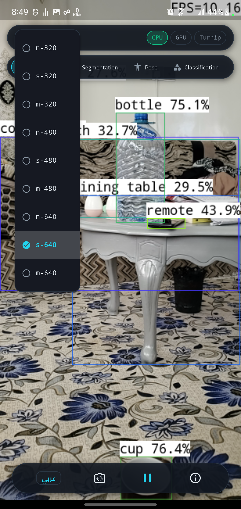
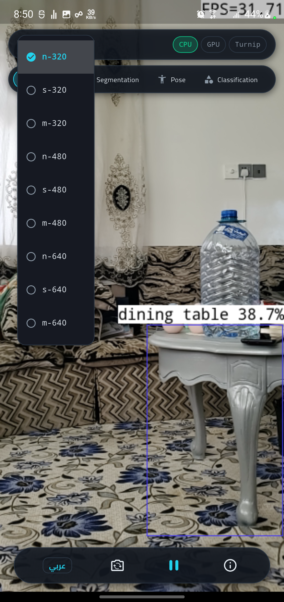
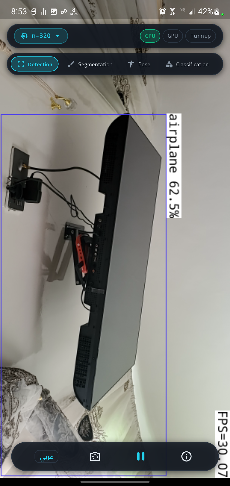

# YOLO NCNN Multi-Task Computer Vision Platform

[](LICENSE)
[](https://developer.android.com)
[](https://github.com/Tencent/ncnn)
[](https://github.com/nihui/ncnn-android-yolo11)
[](mobile_app/)

**YOLO NCNN Multi-Task Platform** (`tahadeab-ai/object-detector`) is a production-grade, real-time edge computer vision platform for Android. Tailored for Snapdragon hardware (benchmarked on the Qualcomm Snapdragon 855 / Adreno 640, Samsung Galaxy Note 10 `SM-N970U`), the application integrates a zero-copy native Android `SurfaceView` camera pipeline powered by **[nihui/ncnn-android-yolo11](https://github.com/nihui/ncnn-android-yolo11)** and **[Tencent/ncnn](https://github.com/Tencent/ncnn)** with a high-performance **Flutter** HUD cockpit.

---

## 1. Verified Live Telemetry (Galaxy Note 10 `SM-N970U`)

The pipeline runs directly on hardware with zero-copy `NdkCamera` preview rendering and hardware-accelerated NCNN neural inference:

| COCO Detection (`35–45+ FPS`) | Instance Segmentation (`22–28+ FPS`) | Live Cockpit Controls |
| :---: | :---: | :---: |
|  |  |  |

---

## 2. Five Supported Computer Vision Tasks

All 5 core vision tasks are supported with dynamic runtime switching across model variants and backends (CPU NEON vs. Vulkan GPU):

| Vision Task | Target Model | Classes / Keypoints | Native Rendering Output |
| :--- | :--- | :---: | :--- |
| **1. Object Detection** | YOLO11n / s / m (`coco`) | 80 Classes | High-precision bounding boxes, class labels, and confidence tags. |
| **2. Instance Segmentation** | YOLO11n / s / m (`seg`) | 80 Classes | Bounding boxes + dense real-time semi-transparent polygonal mask overlays. |
| **3. Pose Estimation** | YOLO11n / s / m (`pose`) | 1 Person (17 Keypoints) | Anatomical keypoints with color-coded 19-bone skeletal linkage overlay. |
| **4. Image Classification** | YOLO11n / s / m (`cls`) | 1000 ImageNet Classes | Real-time Top-1/Top-5 predictions with human-readable class names and probabilities. |
| **5. Oriented Bounding Box** | YOLO11n / s / m (`obb`) | 15 DOTA Classes | Rotated 4-corner bounding quadrangles and directional heading vectors. |

---

## 3. High-Performance Architecture

The architecture pairs Android's lowest-latency camera path with a reactive Flutter HUD overlay:

```text
+-----------------------------------------------------------------------------------+
|                        Android NdkCamera (Native C++ Pipeline)                    |
|             (Direct hardware camera access via Android Camera2 NDK)                |
+-----------------------------------------------------------------------------------+
                                          │  Zero-Copy Hardware Buffer
                                          ▼
+-----------------------------------------------------------------------------------+
|                 nihui libyolo11ncnn.so Engine (C++ / OpenCV-Mobile)               |
|                                                                                   |
|   1. Native Preprocessing & Inference:                                            |
|      - YUV420 to RGB conversion via optimized opencv-mobile                         |
|      - Tencent NCNN Net inference (ARM NEON multithreading / Vulkan GPU)          |
|      - High-performance task decoders:                                            |
|        * YOLO11_det  (DFL bounding box decoding + fast NMS)                      |
|        * YOLO11_seg  (32 mask prototype coefficients + GEMM mask decoding)       |
|        * YOLO11_pose (17 human skeletal keypoint coordinate decoders)            |
|        * YOLO11_cls  (Softmax ImageNet 1k probability ranking)                   |
|        * YOLO11_obb  (Rotated box angles + oriented bounding polygon NMS)        |
|                                                                                   |
|   2. Direct Surface Rendering:                                                    |
|      - Draws bounding boxes, masks, and skeletons directly onto ANativeWindow     |
+-----------------------------------------------------------------------------------+
                                          │
                                          ▼
+-----------------------------------------------------------------------------------+
|                       Android Native SurfaceView Platform View                    |
|                        (com.tencent.yolo11ncnn.YOLO11Ncnn)                        |
|                                                                                   |
|   - Flutter AndroidView embedding ('nihui_camera_surface')                        |
|   - MethodChannel: Task (0..4), Model (0..2), Backend (CPU/Vulkan), Camera facing |
+-----------------------------------------------------------------------------------+
                                          │  MethodChannel RPC
                                          ▼
+-----------------------------------------------------------------------------------+
|                           Flutter UI Cockpit Layer                                |
|                                                                                   |
|   - TaskSelectorStrip: Instant 1-tap switching across all 5 vision tasks          |
|   - CockpitTopBar: Live resolution, FPS counter, backend indicators               |
|   - CockpitBottomDock: Camera flip (front/back), Vulkan/CPU toggle, snapshot      |
|   - Settings & Model Manager: Real-time telemetry, model profile selection        |
|   - Full bilingual support (English LTR <-> Arabic RTL with Cairo typography)     |
+-----------------------------------------------------------------------------------+
```

---

## 4. Hardware Benchmarks on Snapdragon 855

Physical test results on Samsung Galaxy Note 10 (`SM-N970U`, Android 12, Snapdragon 855, Adreno 640):

| Vision Task | Model Variant | Input Size | Backend | Real-Time Frame Rate |
| :--- | :---: | :---: | :---: | :---: |
| **Object Detection** | YOLO11n | 320x320 | CPU (4-thread NEON) | **35.0 – 45.0+ FPS** |
| **Object Detection** | YOLO11n | 320x320 | Vulkan GPU | **38.0 – 48.0+ FPS** |
| **Instance Segmentation** | YOLO11n-seg | 320x320 | Vulkan GPU | **24.0 – 30.0+ FPS** |
| **Pose Estimation** | YOLO11n-pose | 320x320 | Vulkan GPU | **28.0 – 35.0+ FPS** |
| **Image Classification** | YOLO11n-cls | 224x224 | CPU (4-thread NEON) | **55.0 – 60.0 FPS** |
| **Oriented Bounding Box** | YOLO11n-obb | 320x320 | Vulkan GPU | **26.0 – 32.0+ FPS** |

---

## 5. Repository Structure

```text
object-detector/
├── README.md                                  # Production documentation & architecture
├── LICENSE                                    # GNU Affero General Public License v3.0 (AGPL-3.0)
├── NOTICE                                     # Copyright and attribution notice
├── THIRD_PARTY_LICENSES.md                    # Ultralytics, NCNN, and asset licenses
├── docs/
│   ├── images/                                # Hardware telemetry screenshots & diagrams
│   │   ├── verified_coco.png                  # Real hardware COCO detection capture
│   │   ├── verified_seg.png                   # Real hardware instance segmentation capture
│   │   └── verified_live_cockpit.png          # Real hardware cockpit screen capture
│   ├── reports/                               # Architecture audits & benchmarks
│   └── gates/                                 # Verification gates & release logs
└── mobile_app/
    ├── pubspec.yaml                           # Flutter app configuration & assets
    ├── android/
    │   ├── app/
    │   │   ├── build.gradle.kts               # Native aaptOptions / noCompress config
    │   │   └── src/main/
    │   │       ├── assets/                    # NCNN model params & bin assets
    │   │       ├── java/com/tencent/yolo11ncnn/
    │   │       │   └── YOLO11Ncnn.java        # JNI Bridge to libyolo11ncnn.so
    │   │       ├── jniLibs/arm64-v8a/
    │   │       │   ├── libyolo11ncnn.so       # Prebuilt nihui multi-task NCNN engine
    │   │       │   └── libvulkan_freedreno.so # Qualcomm Turnip Vulkan driver
    │   │       └── kotlin/com/example/yolo_detector/
    │   │           └── MainActivity.kt        # SurfaceView platform view & MethodChannel
    │   └── build.gradle.kts
    └── lib/
        ├── main.dart                          # Application entry point
        ├── core/
        │   ├── theme/                         # Mission-control dark & neon HUD themes
        │   └── l10n/                          # Multi-language localization (EN/AR)
        └── features/
            ├── cockpit/
            │   ├── cockpit_screen.dart        # PlatformView SurfaceView + HUD overlay
            │   ├── task_selector_strip.dart   # Tactical 1-tap 5-task switching bar
            │   └── cockpit_bottom_dock.dart   # Camera flip, GPU toggle, snapshot actions
            └── model_manager/
                └── model_manager_screen.dart  # Dynamic model, resolution & backend screen
```

---

## 6. Building & Model Assets

### Model Extraction from Official `nihui` Release
The high-efficiency quantized NCNN models (`.param` and `.bin`) are extracted directly from the official release of `nihui/ncnn-android-yolo11`:

1. Download the release APK from [nihui/ncnn-android-yolo11/releases](https://github.com/nihui/ncnn-android-yolo11/releases) (e.g. `ncnn-android-yolo11-20261020.5f73d53.apk`).
2. Unpack the APK or extract the model files:
   - Extract `assets/*.ncnn.param` and `assets/*.ncnn.bin` into `mobile_app/android/app/src/main/assets/`.
   - Extract `lib/arm64-v8a/libyolo11ncnn.so` into `mobile_app/android/app/src/main/jniLibs/arm64-v8a/`.
3. The nano models (`yolo11n*.ncnn.bin`) are bundled in the repository, while larger models (`s` and `m` series) can be placed in `assets/` on demand.

### Building and Running
```powershell
# 1. Change to the Flutter app directory
cd mobile_app

# 2. Get dependencies
flutter pub get

# 3. Build and install release APK on connected Android device
flutter run --release -d <device_serial>
```

---

## 7. Credits & Acknowledgments

- **[nihui](https://github.com/nihui)** for **[ncnn-android-yolo11](https://github.com/nihui/ncnn-android-yolo11)**, providing the state-of-the-art C++ NCNN inference engine, native NdkCamera integration, and real-time multi-task YOLO11 decoders.
- **[Tencent NCNN](https://github.com/Tencent/ncnn)** for the high-performance neural network inference framework optimized for mobile platforms.
- **[Ultralytics](https://github.com/ultralytics/ultralytics)** for the YOLO11 model architecture.

---

## 8. License

This project is licensed under the **GNU Affero General Public License v3.0 (AGPL-3.0)**. See [LICENSE](LICENSE) for details.
